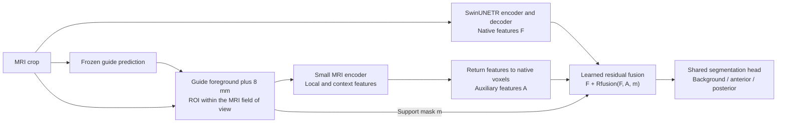

# Thesis results and decisions for the supervisor meeting

Updated 13 October 2026 · One-hour meeting · Suggested allocation: 40 minutes presenting, 20 minutes discussing decisions.

**Opening message:** “Spatial supervision can improve segmentation under limited training budgets, across several architectures, pretrained medical adaptation and a nonmedical task. The latest focused-bands recipe now averages 80.22% across three folds and three seeds under our 75-epoch policy. Under the original FLOP cap, its strongest transfer is to 3D U-Net; it does not consistently replace the strongest existing objective on every architecture. The remaining questions concern schedule dependence, independent validation and the experiments required to finish the thesis.”

**Proposed position:** retain the FLOP-capped study as the main comparison of performance under limited optimization compute; include the longer-training evidence and the completed nine-run replication; distinguish repeatable scores from matched gains; prioritize ADNI, including MedSAM3, before adding SAM3 on GeoFWI3D.

All Dice values below are percentages; gains are **percentage points (pp)**. MSD and MedSAM3 use mean anterior/posterior class Dice, excluding background. GeoFWI3D uses binary salt Dice. These experiments use different training and checkpoint policies, so their absolute scores should not form one model leaderboard.

## 1. What is complete and what is still open

| Study | Verified scope | Main result | Interpretation and remaining work |
|---|---|---|---|
| MSD optimization FLOP cap | Four models × 14 objectives × three folds × three seeds; 448 new runs and 56 retained pilot conditions | Positive mean bands gains in all four models | Replicated exploratory validation evidence; distinguish the eight new combinations from the selection pilot |
| Three-class MedSAM3 | Folds 0/1/3 × seeds 17/83/191 × three objectives; 27 adapters | Bands + edge improves all nine comparisons | Complete; update the thesis draft, which still describes the aggregate as pending |
| GeoFWI3D | Six objectives × three folds × three seeds; 54 cells | 71.53% baseline to 73.54% with bands + SDF + edge | Complete; 500-update, validation-selected comparison, with the six pilot cells included |
| Auxiliary branches | Fold 0, selected plane/unwrapped configurations repeated over three seeds at 5% and full data | Both branches improve over native + depth; unfolding itself has no consistent advantage over the plane control | Architecture change helps, but its mechanism should not be attributed to unfolding alone |
| Frozen focused bands + endpoints + depth | Ordinary SwinUNETR; folds 0/1/2 × seeds 0/1/2; nine fresh runs, maximum 75 epochs | **80.217% ± 1.069 pp**, range 78.136–81.502%; all nine runs complete | Repeatability across seeds/folds; the recipe was selected on fold 0 and this is not an independent test or a paired nine-run gain estimate |
| Frozen recipe under the original FLOP cap | Four models × three folds × three seeds; 36 completed new runs | 3D U-Net **82.157%**, +6.052 pp over its previous best objective, with 9/9 paired wins | Strong U-Net transfer; mixed results versus previous winners on SwinUNETR, nnU-Net and UNETR |
| ADNI | Prepared binary dataset and subject-grouped split described in the draft | No verified result table collected for this briefing | Agree the scope, geometry checks, label budget and evaluation protocol |
| SAM3 on GeoFWI3D | Proposed | No result | Optional extension after the core validation work |

The 12 October snapshot at 15:10 recorded an intermediate best of 81.112%. The selected recipe is now **`combo_depth_g100`**, which reached **81.502%** on fold 0/seed 0 and was frozen before the nine-run replication. Its loss settings are fixed; numerical coefficients are recalibrated from each run's own training cases. The new evidence comprises **9/9 standard-schedule replications and 36/36 capped-compute transfers**, verified from the saved 13 October results. [Replication records](/Users/filippofocaccia/Desktop/hippo/docs/experiments/outer_combo_20261012/replication_results_20261013.json), [capped records](/Users/filippofocaccia/Desktop/hippo/reports/capped_winner_31976_20261013/final_results_20261013.json).

## 2. FLOP-capped experiment

**Question answered:** how much segmentation accuracy does each objective achieve under the same cap on estimated optimization arithmetic?

The cap is **31,976.45 GFLOPs**, approximately **3.20 × 10¹³ FLOPs**, per run. It includes model forward, objective evaluation, backward and optimizer arithmetic; calibration is measured separately and excluded. Validation, augmentation, target preprocessing and I/O are also outside the cap. It is therefore an **optimization FLOP cap**, not equal end-to-end cost or equal runtime. [Accounting definition](/Users/filippofocaccia/Desktop/hippo/experiments/compute_budget_reference.json).

The four models use 10 training volumes per fold, 52 validation volumes, 64³ input and batch size one. Baseline budgets correspond to 90 updates for nnU-Net, 206 for SwinUNETR, 245 for UNETR and 563 for the width-16 U-Net. The extra objective cost is included when determining constrained update counts. nnU-Net retains Dice + CE and deep supervision; its baseline should not be labelled “Dice only.”

**Main-slide table: eight new fold/seed combinations, excluding fold 0/seed 0.** Scores use final checkpoints.

| Model | Baseline | + bands | Bands gain | Highest observed objective mean | Gain |
|---|---:|---:|---:|---:|---:|
| nnU-Net | 63.57 | 64.57 | +1.00 | 64.95 | +1.38 |
| SwinUNETR | 52.94 | 56.14 | +3.20 | 63.45 | +10.51 |
| UNETR | 37.54 | 39.83 | +2.29 | 42.88 | +5.34 |
| 3D U-Net width 16 | 64.47 | 74.63 | +10.17 | 75.83 | +11.37 |

The highest observed combinations are bands + SDF + depth CE for nnU-Net; bands + SDF + edge + depth CE for SwinUNETR and UNETR; and bands + edge + depth CE for U-Net. These winners were selected descriptively from the comparison, so lead with the common bands ablation and use the winning combinations as secondary results. Bands improve 8/8 new combinations for nnU-Net, SwinUNETR and U-Net, and 5/8 for UNETR.

**Say:** “The effect depends strongly on the architecture and objective. The FLOP cap makes the resource question explicit, but these scores characterize a limited training regime rather than the maximum performance of each model.”

Keep the [full 14-objective table, both cohorts and SDs](/Users/filippofocaccia/Desktop/hippo/reports/capped_replication_31976_20261007/final_results_table_20261010.md) in backup. Including all nine combinations, baseline → highest observed mean is 63.96 → 65.65, 51.79 → 63.66, 38.16 → 43.35 and 65.08 → 76.10, respectively. Seeds reuse splits; the validation folds are disjoint from one another, but cases can reappear in training/development roles across folds. Run SDs are not confidence intervals.

[Presentation figure](/Users/filippofocaccia/Desktop/hippo/docs/thesis/supervisor_meeting_20261012/figures/01_compute_bands.png).

### New frozen constraint under the same FLOP cap

The new study transfers **focused bands + independent endpoints + depth-balanced CE** to the same four architectures, using the same **31,976.45 GFLOP optimization cap**. It adds 36 runs and reuses each model/fold/seed's saved baseline and original-bands references. Each architecture retains its native region loss and capped-training recipe, including nnU-Net's Dice + CE and deep supervision. These results use **final-budget checkpoints**, while the 75-epoch SwinUNETR replication in Section 6 uses **best validation checkpoints**.

**All nine fold/seed combinations per model, including fold 0/seed 0:**

| Model | Baseline | Original bands | Strongest previous objective | New recipe, mean ± run SD | Δ vs baseline | Δ vs previous best | Wins vs previous best |
|---|---:|---:|---:|---:|---:|---:|---:|
| 3D U-Net width 16 | 65.08 | 74.78 | 76.10 | **82.16 ± 3.18** | +17.07 | **+6.05** | **9/9** |
| SwinUNETR | 51.79 | 54.70 | 63.66 | **63.91 ± 10.49** | +12.11 | +0.25 | 2/9 |
| nnU-Net | 63.96 | 65.22 | 65.65 | **64.66 ± 10.40** | +0.70 | −0.99 | 1/9 |
| UNETR | 38.16 | 40.56 | 43.35 | **41.70 ± 19.40** | +3.54 | −1.66 | 3/9 |

“Previous best” means one objective selected by its nine-run mean for each architecture, then compared within the same fold/seed; it is not a different per-cell oracle. These are bands + edge + depth for U-Net; bands + SDF + edge + depth for SwinUNETR/UNETR; and bands + SDF + depth for nnU-Net. Against the plain baseline, paired wins are 9/9 for U-Net, SwinUNETR and nnU-Net, and 7/9 for UNETR. Against original bands, wins are 9/9, 7/9, 3/9 and 4/9, respectively.

**Sensitivity excluding fold 0/seed 0**, matching the eight-cell cohort used in the earlier main-slide table:

| Model | New mean Dice | Δ vs baseline | Δ vs original bands | Δ vs previous best |
|---|---:|---:|---:|---:|
| 3D U-Net width 16 | 81.79 | +17.32 | +7.15 | **+5.95** |
| SwinUNETR | 63.07 | +10.13 | +6.93 | **−0.38** |
| nnU-Net | 64.28 | +0.72 | −0.29 | **−0.67** |
| UNETR | 41.20 | +3.66 | +1.37 | **−1.68** |

This sensitivity retains the previous-best objective selected from the full nine-cell historical study. Excluding the development cell does not erase all prior data reuse, but it shows that U-Net's large gain is not driven by that cell. SwinUNETR's small positive overall mean does not constitute a consistent advantage over its previous strongest combination.

**Compute accounting:** the cap is unchanged, but runs stop before the next whole update would exceed it. The new objective's arithmetic and logit backward are charged using an audited conservative bound; comparisons, top-k ranking, indexing and integer operations remain outside this FLOP convention, so the cap does not imply equal runtime.

| Model | New updates | Charged optimization GFLOPs | Additional calibration GFLOPs | Native prefix / constraint ramp, updates |
|---|---:|---:|---:|---:|
| 3D U-Net width 16 | 562 | 31,957.80 | 193.74 | 50 / 50 |
| SwinUNETR | 206 | 31,956.01 | 524.49 | 50 / 50 |
| nnU-Net | 89 | 31,633.22 | 1,189.79 | 9 / 9 |
| UNETR | 245 | 31,894.40 | 435.39 | 50 / 50 |

Calibration is separately reported and excluded from the cap, as in the original study. Target preparation, validation, augmentation and I/O are also excluded. The capped experiment adapts the frozen loss to each model's existing prefix/ramp schedule; it does not reproduce the full 75-epoch training trajectory.

**Say:** “The new loss improves mean Dice over the native baseline on all four models under the same optimization cap. Its strongest added value over our previous constraints is on 3D U-Net, where all nine paired runs improve. Transfer depends on the architecture and training regime; the loss selected on SwinUNETR's longer schedule is not a universal winner at this much shorter compute budget.”

[Saved comparison](/Users/filippofocaccia/Desktop/hippo/reports/capped_winner_31976_20261013/final_comparison_20261013.json), [independently recomputed nine/eight-cell summaries and paired values](/Users/filippofocaccia/Desktop/hippo/docs/thesis/supervisor_meeting_20261012/results_update_20261013.json), [loss accounting](/Users/filippofocaccia/Desktop/hippo/reports/capped_winner_31976_20261013/loss_profile.json).

## 3. Longer training and the main comparison decision

The historical SwinUNETR evidence already answers part of the question. Compare fold 0 with itself, using three seeds in every row:

| Schedule policy | Baseline | Bands | Paired gain |
|---|---:|---:|---:|
| Maximum 75 epochs | 73.146 | 77.081 | +3.935 |
| Common maximum 200 epochs | 79.285 | 80.024 | +0.739 |
| Mixed maximum 200/200/400 epochs | 80.051 | 80.358 | +0.308 |

These are validation-selected checkpoints under maximum-epoch policies, not a guarantee that every arm completed exactly that many epochs. The mixed schedule includes a post hoc extension of seed 2. Duration and learning-rate decay timing change together, so the experiment does not isolate a purely causal “training longer” effect. [Independent audit](/Users/filippofocaccia/Desktop/hippo/docs/experiments/low_data_independent_audit_20260919/AUDIT_REPORT.md).

**Use this wording:** “On the tested fold, the observed bands advantage becomes much smaller under longer schedules with stretched learning-rate decay. This supports a schedule-dependent benefit and motivates studying performance throughout training.”

Include these results in the thesis. Do not claim the advantage disappears, that all architectures behave this way, that convergence has been proved, or that fewer epochs automatically save wall-clock time. In particular, calibration overhead can offset a small epoch advantage.

**Main question to ask:**

> “Should the thesis primarily evaluate accuracy under a fixed optimization FLOP budget, with matched training schedules and longer runs as complementary analyses? Or do you expect the main claim to concern final accuracy after sufficiently long training?”

**Follow-up:**

> “Would you want fixed-epoch or fixed-update comparisons for every model, or would representative schedule-sensitivity experiments be sufficient? I propose reporting both Dice versus compute and Dice versus updates, with calibration and runtime separately.”

My recommendation is to keep both questions visible. Equal compute addresses resource efficiency; matched updates or epochs within the same dataset address the effect of the objective under the same exposure and schedule. Neither substitutes for the other, and fixed epochs across architectures do not equalize cost.

A bounded proposal is baseline versus original bands on nnU-Net and SwinUNETR, with prespecified budgets B, 2B and 4B and three paired seeds on one fold. That is 36 cells, or 24 additional runs if the 12 existing B cells meet the exact frozen protocol. This is a sensitivity study, not proof of convergence; set the learning-rate policy in advance and distinguish continuation of one trajectory from retraining with budget-specific schedules. Do not pick a new budget because it produces the largest constraint gain.

[Presentation figure](/Users/filippofocaccia/Desktop/hippo/docs/thesis/supervisor_meeting_20261012/figures/05_schedule_sensitivity.png).

## 4. MedSAM3 three-class fine-tuning

Use the completed **background/anterior/posterior** replication, not the retired binary experiment. Each comparison uses five support volumes, 200 updates and matched initialization/sampling; the SAM3 base stays frozen while the medical LoRA adapter is fine-tuned. Validation cohorts contain 46, 52 and 44 volumes in folds 0, 1 and 3.

| Fold, mean over three seeds | Baseline | + bands | + bands + edge |
|---|---:|---:|---:|
| 0 | 73.463 | 78.356 | 79.599 |
| 1 | 73.887 | 78.889 | 79.262 |
| 3 | 77.432 | 79.034 | 81.504 |
| Equal-fold average | **74.93** | **78.76** | **80.12** |

The overall gains are approximately **+3.83 pp** and **+5.19 pp**. Bands improve 8/9 comparisons; bands + edge improves 9/9. Equal-fold averages here are calculated from the preserved report's rounded fold means.

**Say:** “The constraint benefit also appears during adaptation of a pretrained medical model with only five labelled support volumes. This extends the evidence beyond models trained from scratch.”

The folds were selected after earlier binary outcomes, so this is exploratory replication rather than unbiased full cross-validation. Repeated seeds do not create additional patients; patient identities were unavailable. Gains generally involve recovering missed foreground, with additional false-positive foreground in several comparisons; inspect the classwise and swap tables rather than treating Dice as complete anatomical evidence.

The separate fold-0/seed-46 pilot scored 75.62 → 78.97 → 80.85. Do not mix it into the replication mean. The current thesis revision still has a placeholder for this completed replication, which should be replaced in a later writing pass.

[Preserved audited report](/Users/filippofocaccia/Desktop/hippo/docs/thesis/supervisor_meeting_20261012/medsam3_replication_preserved_report.md), [protocol](/Users/filippofocaccia/Desktop/hippo/docs/experiments/medsam3_multiclass_replication_20260930/PROTOCOL.md), [presentation figure](/Users/filippofocaccia/Desktop/hippo/docs/thesis/supervisor_meeting_20261012/figures/02_medsam3.png).

## 5. Nonmedical segmentation on GeoFWI3D

**What the examples show.** Each row is a slice from a different synthetic 96 × 96 × 96 seismic volume: a scene generated with one salt body, and a scene generated with three salt bodies plus faults. The model receives the grayscale seismic image; the teal reference target marks all salt material as one foreground class, including disconnected pieces. These are dataset illustrations, not predictions. A single slice need not intersect every body in the 3D scene.

**Say:** “This is a different image domain, but the learning problem is still voxelwise 3D segmentation: identify the full salt region from the seismic image. The constraints supervise its boundary and surrounding background; they do not require a medical organ.” The experiment uses 479 salt-containing scenes, so it tests segmentation when salt is present rather than salt detection across all scenes. Distances are measured in native voxels because physical spacing is not supplied.

The displayed cases are `model_0002` and `model_0001`, with the same corrected target rule used by preparation: zero relative geological time **and** velocity matching the scene's salt velocity. Those two physical fields construct the labels; neither is a model input. Each displayed Y slice maximizes foreground area, and image contrast uses per-volume 99.5th-percentile absolute-amplitude clipping. [Dataset preparation protocol](/Users/filippofocaccia/Desktop/hippo/docs/experiments/geofwi3d_swinunetr_20261004/PIPELINE.md), [example selection and source hashes](/Users/filippofocaccia/Desktop/hippo/docs/thesis/supervisor_meeting_20261012/dataset_examples_provenance.json).

This is synthetic 3D seismic salt-body segmentation. The repeated experiment uses SwinUNETR, 19 training volumes per fold, 96 validation volumes per fold and 500 updates. The baseline is Dice + CE. The checkpoint is selected from validation every 100 updates; this is not the final-checkpoint policy used by the FLOP study.

| Objective added to baseline | Mean Dice | Gain | Improved fold/seed combinations |
|---|---:|---:|---:|
| None | 71.53 | — | — |
| Bands | 73.05 | +1.52 | 8/9 |
| SDF | 72.09 | +0.56 | 7/9 |
| Bands + SDF | 73.43 | +1.90 | 9/9 |
| Bands + edge | 73.11 | +1.59 | 8/9 |
| Bands + SDF + edge | 73.54 | +2.01 | 9/9 |

The six fold-0/seed-0 pilot cells are included. Excluding them, baseline is 71.25%, bands 72.57% (+1.32 pp), and the full combination 73.17% (+1.92 pp). The direction of the mean benefit therefore persists in the eight new combinations.

**Say:** “The tested spatial losses also improve a second 3D segmentation task outside medicine, under a short update budget.” This supports transfer of the supervision idea; it does not establish benefit on every nonmedical domain or after long training.

The original longer baseline reached 83.27% with 19 training volumes, 92.88% with 77 and 93.84% with 383, on one split/seed. Those values provide context about training duration and label availability, but there is no matched long-budget constrained comparison in that table. LEGO was retired after an interrupted crop-based run and should remain a brief development-history note, not part of the completed benchmark.

[Replication results](/Users/filippofocaccia/Desktop/hippo/reports/geofwi3d_replication_20261011/results/RESULTS.md), [protocol](/Users/filippofocaccia/Desktop/hippo/docs/experiments/geofwi3d_replication_20261011/PROTOCOL.md), [longer baselines](/Users/filippofocaccia/Desktop/hippo/docs/experiments/geofwi3d_swinunetr_20261004/RESULTS.md), [presentation figure](/Users/filippofocaccia/Desktop/hippo/docs/thesis/supervisor_meeting_20261012/figures/03_geofwi3d.png).

## 6. Auxiliary branches and progress on bands

The key finding is that **a second, ROI-focused processing path can reach about 82% validation Dice even when the MRI stays on its original voxel grid**. The evidence supports the usefulness of the branch under this training protocol; it does not establish unwrapping as the source of the improvement.

### How the auxiliary branch works

The main SwinUNETR receives the full available hippocampal MRI crop, padded to 64³, and computes its usual encoder/decoder features. In parallel, a small convolutional encoder processes MRI samples from a guide-defined hippocampal region plus surrounding tissue. Its features are returned to the original voxel locations and fused with the final SwinUNETR decoder features before the segmentation head. The main network, auxiliary encoder and fusion layers train jointly; the final output remains one native-grid background/anterior/posterior segmentation.

For a nontechnical explanation: **the model examines the same scan through two processing paths—one covering the full crop and one focused around the hippocampus—and combines what they learn before deciding each voxel's class.** The extra path remains part of prediction at inference; it is an architectural addition, whereas the bands penalty operates during training.

| Auxiliary representation | What changes |
|---|---|
| Plane view | Organizes the selected MRI samples using coordinates in a guide-derived anatomical plane and distance from that plane, with the two sides kept separate. A 3D encoder processes this resampled representation and its features are mapped back to the native grid. |
| Unwrapped view | Uses flattened surface-chart coordinates and physical distance from the cutting plane to organize the same selected MRI samples. This changes the neighborhoods processed by the encoder, but rasterization and return interpolation mean it is not an exactly invertible volume warp. |
| Native view | Places the selected MRI samples at their original voxel centers and axis orientation, without plane resampling or unwrapping. It retains the same guide-defined ROI and separate source groups for context pooling, then uses the same kind of encoder and feature fusion. |

The plane and unwrapped families also tested context, explicit position/depth channels and attention. The **5% native-view control discussed here uses MRI-only auxiliary convolutions, context and ordinary fusion**, with no explicit position/depth channels or attention gate. [View construction](/Users/filippofocaccia/Desktop/hippo/scripts/unwrapped_swin/geometry.py), [encoder and fusion](/Users/filippofocaccia/Desktop/hippo/scripts/unwrapped_swin/models.py), [native-view and MRI-only implementation](/Users/filippofocaccia/Desktop/hippo/scripts/tissue_profiles/mri_views.py).

### What “the same hippocampus volume plus 8 mm” means

1. **Locate the region using a frozen guide prediction.** Include predicted foreground and voxels within 8 mm of it, intersected with the real MRI field of view. The margin supplies nearby background and image context and allows the selected region to extend beyond an imperfect predicted boundary; 8 mm is a protocol choice, not an established optimum. This margin sets the auxiliary input context; the bands experiment's widths set where training errors are penalized.
2. **Keep the original MRI geometry.** Reuse the same source-voxel groups as the plane/unwrapped controls, place their intensities on the original lattice, crop each group's bounding box and pad it. Group membership remains fixed, so this control removes transformed image coordinates but still uses guide-derived localization and grouping.
3. **Learn local and broader context.** The small encoder combines a fine-resolution convolutional stream, a coarser pooled stream and a support-weighted summary of each group. It produces 16 auxiliary feature channels. Only MRI intensities enter its learned input convolutions; valid-support masks control pooling and mapping.
4. **Learn a residual correction before classification.** Map those 16 channels to native voxels and concatenate them with the decoder's 24 feature channels and a one-channel support mask. The fusion layers produce a 24-channel correction, which is added to the native features before the shared output head: `logits = head(F + Rfusion(F, A, m))`. The support mask is therefore available to learned fusion even though the auxiliary encoder is called MRI-only. The final segmentation is not hard-clipped to the guide ROI.
5. **Train the final segmentation with Dice.** The approximately 81.9% result does not require depth balancing, bands or a separate branch segmentation loss. All segmentor components start from scratch and receive gradients through the final Dice objective; the guide geometry stays frozen.

For training cases, two guides trained on opposite halves of the allowed training set produce out-of-fold predictions. Validation geometry comes from the fixed epoch-25 Dice model trained on the allowed training set; validation annotations do not define the ROI or choose the guide checkpoint. A new scan would similarly need guide prediction and ROI construction, so guide preparation and inference are part of the system's cost.

### What the native-view control actually achieved

The original matched view-control study used fold 0, seed 0, ten training cases and 52 validation cases, with a maximum of 75 epochs and validation-based checkpoint selection. These rows all use **Dice alone**:

| Architecture in that study | Validation A/P Dice | Meaning |
|---|---:|---|
| Ordinary SwinUNETR | 74.167% | Baseline for this specific comparison |
| SwinUNETR with direct position/depth/ROI input channels | 75.247% | Extra anatomical inputs alone gave a smaller gain |
| MRI-only plane branch | 81.917% | Transformed auxiliary representation |
| MRI-only unwrapped branch | 81.889% | Flattened auxiliary representation |
| **MRI-only native-view branch** | **81.990%** | **+7.824 percentage points over its own ordinary baseline** |

Thus “81.9%” is the achieved Dice, not the size of the improvement. The later twelve-arm native-branch constraint study trained a fresh Dice control and obtained **81.974%**; adding bands + edge reached **82.253%**. Keep those run identities separate. Likewise, the current bands campaign's 74.304% Dice control belongs to that campaign, while the 74.167% row above is the baseline used to estimate this native-view branch gain.

The native-view model adds **20,984 trainable parameters**, about **0.134%** over the 15,703,029-parameter SwinUNETR. It is a small CNN and fusion module, not another complete SwinUNETR. The plane/unwrapped MRI-only controls match its trainable parameters, but their resampling, spatial kernel scale and padding differ; their small score differences do not establish equivalence or general superiority of any view. [Complete matched results and protocol](/Users/filippofocaccia/Desktop/hippo/docs/experiments/tissue_profiles_20261007/final_results/RESULTS.md).

### Why can reprocessing the same MRI help?

**Working interpretation:** the branch changes how the available evidence is processed. Guide localization supplies a spatial prior; the focused CNN and context pooling can learn local tissue patterns; and late residual fusion gives the decoder another way to refine its features. None of these requires a new image modality or an unwrapped representation. The modest parameter increase also makes “a much larger model” an incomplete explanation, although parameter count alone cannot identify the cause.

The observed error pattern supports a more specific description: in the original native-view comparison, extra foreground fell from **80,273 to 31,599 voxels**, while missed foreground rose from **15,386 to 23,561** and A/P swaps fell from **5,794 to 4,435**, pooled over the 52 validation cases. Mean surface distance improved from 1.0295 to 0.6589 mm. The gain therefore accompanies a large reduction in oversegmentation, with a cost in missed tissue; it is not improvement on every error type.

The existing controls establish that **unwrapping and explicit position channels are unnecessary for this large single-run gain**. They do not isolate the contributions of the auxiliary MRI encoder, ROI support, context pooling and residual fusion. A useful next ablation, if the supervisors want a causal account, is ordinary SwinUNETR → added decoder refinement without ROI input → the same refinement with ROI input → the existing native-view MRI branch, under matched training and multiple seeds. Testing whether 8 mm itself matters requires a separate margin comparison.

**Speaker wording:** “The important control was to keep the same hippocampal region plus an 8 mm margin, but return its MRI samples to their original voxel positions. A small CNN processed that region, and its features were fused with the native decoder; this already reached about 82% with Dice alone. This shows that the large gain does not depend on unwrapping. Our current hypothesis is that spatially focused processing and residual refinement drive much of the benefit, but we still need ablations to separate their effects.”

This native-view control is still one fold and seed. The three-seed experiment below concerns the plane/unwrapped branches and does not replicate the native-view result; the comparisons also use extra architecture and guide computation, rather than the FLOP-capped protocol.

### Earlier replication and the branch reference

| Selected configuration, fold 0 / three seeds | 5% data Dice | Full-data Dice |
|---|---:|---:|
| Native model + depth loss | 74.88 | 87.87 |
| Plane branch | 80.03 | 88.19 |
| Unwrapped branch | 79.73 | 88.21 |

The 5% branch models use position-based configurations; full-data models use attention-based configurations. Both branches beat native + depth in all three seeds. Their improvements come with fewer extra voxels and better average surfaces but more missed tissue, and neither uncertainty-gating variant beats ordinary fusion. [Seed summaries](/Users/filippofocaccia/Desktop/hippo/docs/experiments/unwrapped_followup_20261007/final_results/seed_summary.json), [five experimental answers](/Users/filippofocaccia/Desktop/hippo/docs/experiments/unwrapped_followup_20261007/final_results/five_question_answers.json).

The separate native MRI branch uses a guide-derived hippocampal region and an extra MRI encoder fused with the native decoder. Its strongest recorded loss variant, Dice + bands + edge, reaches 82.253% in fold 0/seed 0; the same branch with Dice alone reaches 81.974%. Training inputs use out-of-fold guides and validation annotations do not construct branch inputs. [Native-branch protocol](/Users/filippofocaccia/Desktop/hippo/docs/experiments/native_branch_constraints_20261008/README.md), [12-arm results](/Users/filippofocaccia/Desktop/hippo/docs/experiments/native_branch_constraints_20261008/RESULTS.md).

### Progression from the supplied figure to the frozen recipe

The [original supplied figure](/Users/filippofocaccia/Desktop/hippo/docs/thesis/supervisor_meeting_20261012/figures/06_user_progression_20261012.png) is preserved unchanged. The plot above preserves the 25-record sequence through **12 October at 15:10**, ending at the intermediate 81.112% result. The subsequent selected development milestones are:

| Development stage, fold 0/seed 0 | Selected validation Dice | What changed |
|---|---:|---|
| Focused bands and independent endpoints | 81.112% | 70%/10% selection; 65%/85% emphasis |
| Rebalanced outer objective | 81.324% | Bands/endpoints gradient targets changed to 12.5%/7.5% |
| **Frozen combination: `combo_depth_g100`** | **81.502%** | Added depth-balanced CE at a 10% gradient target relative to the complete outer objective |

These are selected milestones, not an exhaustive list of all later record setters. The final recipe was frozen and repeated in nine fresh runs, including a new fold 0/seed 0 run that reproduced 81.502%.

**Caption to use:** “Successive validation records for ordinary SwinUNETR on the same 10 training and 52 validation volumes, fold 0/seed 0, maximum 75 epochs. The dashed line is the separately evaluated native MRI auxiliary branch with Dice + bands + edge. The plot shows record-setting configurations rather than all tested outcomes; its horizontal axis is neither training time nor cumulative compute. Later points are not cumulative additions of every previous loss.”

**Talk track:** “We started at 74.30% with Dice and 76.73% with the original bands. Focusing the boundary supervision, retaining independent endpoint targets, rebalancing their strengths and adding depth-balanced supervision brought the selected development result to 81.50% without an auxiliary branch. The frozen recipe then averaged 80.22% across three folds and three seeds. Its development score is 0.75 points below the strongest recorded native-branch arm, but the replicated loss and single-run branch reference are different evidence levels.”

Do not compare the nine-run 80.22% loss mean with the single-seed 82.253% branch reference or the earlier branch means as a matched experiment. The branch has different architecture, guide costs and controls; the visual gap between development scores is not an equal-compute comparison or an equivalence test.

### How the current best loss works

The frozen recipe is **`combo_depth_g100`**, based on `w81_strength_qi70_qo10_mi65_mo85_b125_p75`; its capped-transfer name is `dice_focus_bands_pair_depth`. The model remains ordinary three-class SwinUNETR in the standard-schedule replication; all added geometry is training supervision, and inference needs only the MRI. The recipe has three added components: focused bands, independent endpoints and depth-balanced CE. SDF, the original edge term and an auxiliary encoder are not part of this winner.

1. **Choose where to supervise.** Use the annotated whole-hippocampus boundary, with a 3 mm band inside and a 2 mm band outside. Exclude padding. The foreground probability is the sum of anterior and posterior probabilities.
2. **Measure the membership error.** Use squared probability error: `(1 − p_foreground)²` inside and `p_foreground²` outside. These are Brier errors.
3. **Focus separately on each side.** At each forward pass select the hardest 70% of inside-band voxels and the hardest 10% outside. Inside, combine `35% × mean error over the whole side + 65% × mean error over its selected subset`; outside, combine `15% × whole-side mean + 85% × selected-subset mean`.
4. **Balance the two sides.** Give the inside and outside side losses equal total weight. The 70%/10% numbers are selection fractions, while 65%/85% are within-side emphasis weights; neither changes the equal total weighting of inside and outside.
5. **Retain independent endpoint targets.** Add separate foreground/background membership targets at endpoints of annotated crossings with 1 mm and 3 mm total separation, equally weighting the two distances and the two sides. Each endpoint is supervised independently rather than only requiring a large probability difference between them.
6. **Balance anatomical depth in the region loss.** Add three-class CE weighted across signed 2 mm bins relative to an annotation-derived longitudinal plane, within annotated foreground plus an 8 mm background margin. Each sufficiently populated bin has equal total weight; bins below 64 voxels receive less mass. This discourages large depth regions from dominating supervision. It uses annotation geometry during training, not a guide-derived input branch at inference.
7. **Calibrate the three terms in sequence.** After five Dice-only epochs, target a median logit-gradient RMS ratio of 12.5% for bands relative to Dice, then 7.5% for endpoints relative to Dice + weighted bands, then 10% for depth CE relative to that complete outer objective. A p95 ratio cap of 0.5 limits each calibration. These are gradient targets, not percentages of the numerical loss. Ramp all added terms during epochs 6–10, then retain their calibrated coefficients; difficult voxels are still reselected from the changing predictions. Each replication recalibrates on its own ten training cases while keeping the recipe fixed.

In compact notation, with `mean_topq` denoting the mean of the largest fraction q of current errors:

`L_inside = 0.35 mean(e_inside) + 0.65 mean_top70%(e_inside)`

`L_outside = 0.15 mean(e_outside) + 0.85 mean_top10%(e_outside)`

`L_total = L_Dice + ramp × [λ_band × 0.5(L_inside + L_outside) + λ_endpoints × L_independent_endpoints + λ_depth × L_depth_CE]`

The whole-side means ensure that unselected voxels still contribute. A voxel in the hardest subset contributes through both terms; the 65% and 85% emphasis weights describe mixtures of means, not percentages of total gradient assigned to selected voxels. Bands and endpoints supervise the external foreground boundary; Dice and depth-balanced three-class CE also supervise class identity. In the capped transfer, replace `L_Dice` with each architecture's native region objective and use the prefix/ramp counts in Section 2.

**Development comparison on fold 0/seed 0**, with errors summed over the same 52 validation volumes:

| Metric | Original bands | Current best |
|---|---:|---:|
| A/P macro Dice | 76.727% | 81.502% |
| Extra foreground voxels | 64,806 | 30,413 |
| Missed foreground voxels | 16,923 | 25,901 |
| A/P swaps | 5,203 | 4,609 |
| Mean surface distance | 0.904 mm | 0.698 mm |
| HD95 | 2.053 mm | 1.668 mm |

The selected development gain is **+4.774 pp over original bands**, **+7.198 pp over the campaign's Dice control**, and **+0.390 pp over the earlier 81.112% formulation**, calculated before rounding. The score is **0.751 pp below** the 82.253% branch reference. Against original bands, the final recipe reduces extra foreground by 34,393 voxels and swaps by 594, but increases missed tissue by 8,978. These are development-cell differences, not nine-run mean improvements.

The working hypothesis is that asymmetric boundary focus, endpoint membership and depth-balanced class supervision complement one another. The development search does not establish a universal optimal ratio or prove that the auxiliary branch's mechanism has been reproduced.

[Historical progression notes and current speaker update](/Users/filippofocaccia/Desktop/hippo/docs/thesis/supervisor_meeting_20261012/BANDS_PROGRESSION_NOTES.md), [frozen combination plan](/Users/filippofocaccia/Desktop/hippo/docs/experiments/outer_combo_20261012/PLAN.md), [combination and calibration implementation](/Users/filippofocaccia/Desktop/hippo/scripts/band_focus/combo_objectives.py), [capped recipe](/Users/filippofocaccia/Desktop/hippo/scripts/capped_winner/objectives.py), [updated development comparison figure](/Users/filippofocaccia/Desktop/hippo/docs/thesis/supervisor_meeting_20261012/figures/04_bands_branch.png).

### Consistency across three seeds and three folds

All **nine fresh runs** are complete. Each fold has ten fixed training cases and 52 validation cases; seeds 0/1/2 change training randomness while retaining that fold's subset. The recipe was selected before these runs; its numerical weights are recalibrated using training cases only. The standard policy remains maximum 75 epochs, StepLR every 20 epochs, early stopping and best-validation checkpoint selection.

| Fold | Seed 0 | Seed 1 | Seed 2 | Mean ± seed SD |
|---|---:|---:|---:|---:|
| 0 | 81.502 | 81.088 | 80.082 | **80.890 ± 0.730** |
| 1 | 81.173 | 79.846 | 79.247 | **80.089 ± 0.986** |
| 2 | 80.822 | 80.062 | 78.136 | **79.673 ± 1.385** |
| All nine runs | — | — | — | **80.217 ± 1.069** |

**Say:** “The approximately 80% performance repeats across three seeds and three folds: all nine scores lie between 78.14% and 81.50%, with a mean of 80.22%. This is stronger evidence of repeatability than the original single best run. Seed 2 is consistently lower, so initialization still matters.”

Do not turn this into “the gain is confirmed in 9/9 runs”: this nine-run table contains the frozen recipe, not nine matched standard-schedule baseline/old-bands comparisons. The equal-FLOP experiment provides separate paired comparisons under a different schedule. Standard-schedule seed-2 runs also have worse surface metrics: HD95 is 3.05, 3.34 and 4.79 mm across folds, compared with 1.67–1.97 mm for seeds 0/1. Similar Dice does not guarantee equally consistent contours.

Fold 0 informed recipe selection; its rerun is a reproducibility check, not independent confirmation. The validation folds are mutually disjoint, but their cases can appear in other folds' training/development data, and all seeds reuse each fold's validation set. Accordingly, the overall SD is descriptive run variation, not a confidence interval or an untouched-test estimate. The native branch has not received an otherwise matched nine-run comparison. [All nine records and surface metrics](/Users/filippofocaccia/Desktop/hippo/docs/experiments/outer_combo_20261012/replication_results_20261013.json), [recomputed summaries](/Users/filippofocaccia/Desktop/hippo/docs/thesis/supervisor_meeting_20261012/results_update_20261013.json).

## 7. Questions to take to the supervisors

### A. Main thesis claim and comparison protocol

> “Should the central thesis claim be improved accuracy under limited optimization compute, improved final accuracy, or both? My proposal is to retain the FLOP-capped benchmark as the main comparison and add a bounded schedule-sensitivity study, including the existing evidence that the gain becomes smaller with longer training.”

Decision needed: primary claim, whether fixed epochs/updates belong in the main chapter or appendix, which models need longer runs, and the budget for those runs. Report the existing long-schedule evidence regardless of the decision to run more experiments.

### B. ADNI, explicitly including MedSAM3

**What the examples show.** These are two actual 32 × 48 × 40 MRI crops from the prepared ADNI collection: a left hippocampus and a right hippocampus from different scans. Teal marks the reference whole-hippocampus foreground. Unlike MSD's anterior/posterior task, this exported dataset has only background and hippocampus labels, so the proposed ADNI experiment measures binary segmentation.

**Say:** “ADNI would test the same supervision idea on another medical collection. These examples show the input and the available target: we can test whole-hippocampus constraints here, but not anterior/posterior separation with the current labels.” The panels show reference masks, not ADNI model results.

Examples are `hippocampus_adni_10007_L` and `hippocampus_adni_106775_R`, selected as the first left training crop and first right validation crop in lexicographic order within saved fold 0. Each displayed slice maximizes foreground area along array axis 0, with a per-volume 1st–99th percentile MRI window. The exports have identity affines, so the panels use native-array coordinates without anatomical plane names or millimetre scale bars. [Dataset labels](/Users/filippofocaccia/Desktop/hippo/datasets/Dataset103_ADNI/dataset.json), [crop builder](/Users/filippofocaccia/Desktop/hippo/datasets/Dataset103_ADNI/create_adni_dataset.py), [example provenance](/Users/filippofocaccia/Desktop/hippo/docs/thesis/supervisor_meeting_20261012/dataset_examples_provenance.json).

> “Should I use ADNI as the second medical dataset for both the FLOP-capped study and MedSAM3 fine-tuning? I propose transferring a small, frozen set of objectives first—baseline, bands and bands + edge—then expanding only if the additional comparisons answer a specific thesis question.”

**Recommendation: yes, include MedSAM3 on ADNI.** It directly tests whether the medical adaptation result transfers to a second collection and complements the from-scratch benchmark. ADNI uses binary whole-hippocampus labels, so transfer applicable foreground bands/edge/SDF terms; it cannot validate MSD's anterior/posterior constraints or its A/P depth-balancing construction unchanged.

The current draft describes 135 subjects and 270 bilateral crops, with five splits containing 108 training and 27 validation subjects. Keep both hippocampi of a subject in the same partition and select scarce-label support sets at subject level. Explicitly decide whether “five-shot” means five subjects or five crops: five subjects with both sides gives ten crops and is not the same annotation count as five MSD support volumes.

Before training, verify original physical spacing/orientation because the builder exports identity affines; distances in millimetres require recovered geometry. Crops are reference-mask localized, so describe the experiment as segmentation of localized hippocampi. Reprofile the binary models and objectives to obtain the update counts under the chosen cap, rather than copying MSD update counts. Check pretraining overlap before describing ADNI as unseen to the foundation model.

For scale: four models × three objectives × three folds × three seeds is 108 runs; MedSAM3's three objectives × three folds × three seeds adds 27. This **135-run core proposal** is a planning option, not an approved launch or a requirement to replay every historical ablation. SDF and the frozen improved bands formulation can be added if the supervisors identify them as necessary.

### C. SAM3 on the nonmedical dataset

> “Would fine-tuning SAM3 on GeoFWI3D add enough evidence about constraint-guided foundation-model adaptation to justify the work, or is the completed SwinUNETR nonmedical study sufficient? If useful, may I scope it as a matched baseline/bands/bands-plus-edge pilot with a fixed protocol and report the outcome whether positive or negative?”

Frame the hypothesis as **testing whether the benefit transfers**, not showing that it must work like MedSAM3. SAM3 supports image/video segmentation and fine-tuning, so a seismic-volume experiment needs an explicit slice/volume adaptation and prompt policy; do not assume it is a native 3D replacement. Use a pinned SAM3 version, the same pretrained initialization and trainable parameters within each pair, matched support data and updates, and full-volume evaluation. The medical-adapter initialization is a separate factor. The [official SAM3 repository](https://github.com/facebookresearch/sam3) describes the supported setting.

Prioritize ADNI and any agreed remaining matched controls for the frozen loss first. A successful feasibility check should mean correct learning, valid volume reconstruction and an affordable protocol; it should not mean selecting a seed because constraints happened to win.

### D. Decide what remains after replication and compute transfer

> “The frozen loss now has nine completed standard-schedule replications and 36 capped-compute transfers. Is that sufficient for the main thesis result, or do we also need matched standard-schedule Dice/original-bands controls and a replicated native-branch comparison? Given the strong U-Net transfer and mixed results on the other models, should the next priority be schedule sensitivity or ADNI?”

Do not propose repeating the nine winner cells that are already complete. First audit whether existing standard-schedule Dice and original-bands records match all nine cells' subsets, initialization, optimizer, schedule and checkpoint policy; collect only genuinely missing controls. A matched branch comparison is a separate architecture question with additional guide/encoder cost. Independent evaluation or nested selection is still needed for a stronger generalization claim; excluding fold 0/seed 0 alone does not make the remaining historical data untouched.

> “Should we report the frozen objective as a generally useful option with architecture-dependent effects, rather than claim one universally best constraint? For the FLOP-capped thesis table, may I show the common baseline/bands comparison, the previous strongest objective and the frozen new recipe, with paired wins and the development-cell sensitivity?”

### E. Chapter 2, for Professor Tangherloni

> “For Chapter 2, what background should I assume from the reader? Would you prefer a self-contained introduction to 3D segmentation, architectures and LTN/logLTN, or a shorter chapter focused on the concepts needed to understand my methods? My proposal is to keep the grounding and loss mathematics, compress standard architecture tutorials, and move implementation-specific detail to Methods or an appendix.”

The current [thesis revision](/Users/filippofocaccia/Desktop/hippo/Template_tesi/thesis-revision.tex:446) already covers volumetric segmentation, conventional objectives, architectures, LTN/logLTN, spatial-supervision literature and pretrained adaptation. Ask about expected reader knowledge and the balance with the contribution chapters, rather than a page count alone.

Keep: notation; voxel versus physical geometry; Dice/CE; architecture differences needed to interpret results; LTN/logLTN grounding, operators and the correspondence with implemented losses; and the distinction between pretraining and task adaptation. Compress general encoder/decoder and attention tutorials where citations suffice. Move study-specific update counts, support-set details, exact parameter tables and the current adaptation workflow from background to Methods where appropriate. Preserve the detailed new constraint formulation in its own methods chapter.

### F. Minimum completion criteria

> “Which of these experiments are required for the thesis, which are optional, and what result set would you consider sufficient to stop experimentation and finalize the writing?”

Suggested priority: decide whether any matched controls or schedule analyses are still needed after the completed replication; ADNI with MedSAM3 plus a focused FLOP benchmark; then SAM3 on GeoFWI3D if time remains. Record an explicit priority order and resource limit at the meeting.

## 8. One-hour presentation plan

| Slide | Minutes | Content and spoken takeaway |
|---|---:|---|
| 1. Research question | 1 | “When do spatial constraints help low-data segmentation?” State that the meeting must decide the thesis claim and remaining scope. |
| 2. Evidence map | 1 | Highlight the newly completed nine standard replications and 36 compute-capped transfers. |
| 3. How comparisons are defined | 3 | Explain A/P versus binary Dice; final versus selected checkpoints; equal FLOPs versus equal updates. |
| 4. Original FLOP-capped results | 2 | Show the common bands ablation; keep the full 14-objective table as backup. |
| 5. New loss under the same cap | 4 | Show the four-model table and paired-gain plot. U-Net wins 9/9 against its previous best; the other architectures do not show a consistent replacement. Mention the eight-cell sensitivity. |
| 6. What longer training changes | 3 | Show the three historical rows. The gain shrinks; the central scientific claim needs a clear scope. These are original-bands results, not long-schedule tests of the newly frozen loss. |
| 7. MedSAM3 replication | 4 | Show fold means and 9/9 positive bands+edge comparisons. Explain the corrected three-class task and selected-fold limitation. |
| 8. Nonmedical results | 3 | Start with the seismic input/target examples, then show GeoFWI3D paired gains and the scope of domain transfer. |
| 9. Auxiliary branches | 5 | Walk through the two processing paths and residual fusion. Explain the approximately 82% native-view result and distinguish observations from causal hypotheses. Keep encoder details and the older three-seed table as backup. |
| 10. Bands development | 2 | Show the historical progression and the later 81.112 → 81.324 → 81.502 milestones. The final development gap to the branch reference is 0.751 pp. |
| 11. Frozen recipe and replication | 5 | Explain focused bands, independent endpoints and the added depth CE; show the nine-cell table, 80.217% mean and seed-2 contour sensitivity. Repeatability of scores does not establish nine paired gains. |
| 12. What we can claim | 2 | Repeatable standard-schedule performance; architecture-dependent compute transfer; validation selection and longer-schedule questions remain. |
| 13. Proposed remaining experiments | 2 | Show ADNI MRI/target examples and its binary task. Prioritize agreed missing controls, ADNI/MedSAM3 and optional SAM3. |
| 14. Thesis structure | 3 | Show Chapter 2's six topic groups and the proposed boundary between background and methods. |
| 15. Decisions | 20 | Spend about 8 minutes on the main protocol and new compute result, 5 on ADNI/MedSAM3, 3 on remaining controls/SAM3 and 4 on chapter depth and stopping criteria. |

Backup material: all 14 original FLOP objectives and SDs; all 36 new paired capped results and accounting; the nine standard-run surface metrics; individual MedSAM3 seeds and class errors; all GeoFWI3D cells; historical progression descriptions; and the native-branch 12-arm table.

**Closing request:** “Can we agree the main comparison protocol, which controls or validation are still required after the completed replication, the ADNI scope including MedSAM3, whether SAM3 is optional, and the expected depth of Chapter 2?”

## 9. Actions after the meeting

| Action | Current state | Decision to record |
|---|---|---|
| Refresh MedSAM3 and GeoFWI3D thesis tables | Evidence complete | Writing task; preserve exploratory scope and metric definitions |
| Finalize the comparison claim | Open | Primary FLOP endpoint; complementary schedules and overhead reporting |
| Interpret the frozen constraint | Nine standard replications and 36 capped transfers complete | Which matched standard controls, branch comparison or independent validation are still required |
| Prepare ADNI studies | Protocol decision needed | Geometry, subject-level label budget, objectives, models and compute allowance |
| Add SAM3 on GeoFWI3D | Optional proposal | Whether it adds enough evidence to justify scope |
| Edit Chapter 2 | Draft available | Reader assumptions, topic depth and material moved to Methods |

No training was launched and no thesis source was changed for this briefing update. Numerical checks recomputed the nine-run mean/SD, all 36 capped paired comparisons and the eight-cell sensitivities; checked the unchanged cap and accounting; and matched all 72 baseline/bands references to the original 504-condition record. This is an audit of saved results, not a new training or inference run.

## External reference

SAM3's image/video interface and available fine-tuning code were checked against the [official Meta repository](https://github.com/facebookresearch/sam3). The medical implementation is described in the [MedSAM3 repository](https://github.com/Joey-S-Liu/MedSAM3). These sources establish model interfaces, not the result of the proposed GeoFWI3D experiment.

The figures are available as PNGs and SVGs in the adjacent figures directory; dataset pixels are embedded raster images within their SVGs. [Verified aggregate data and source hashes](/Users/filippofocaccia/Desktop/hippo/docs/thesis/supervisor_meeting_20261012/verified_summary.json), [13 October verification and paired data](/Users/filippofocaccia/Desktop/hippo/docs/thesis/supervisor_meeting_20261012/results_update_20261013.json). [build_figures.py](/Users/filippofocaccia/Desktop/hippo/docs/thesis/supervisor_meeting_20261012/build_figures.py) rebuilds the result figures, including the new replication and capped-transfer panels from [build_results_update.py](/Users/filippofocaccia/Desktop/hippo/docs/thesis/supervisor_meeting_20261012/build_results_update.py). The dataset panels can be regenerated with [build_dataset_examples.py](/Users/filippofocaccia/Desktop/hippo/docs/thesis/supervisor_meeting_20261012/build_dataset_examples.py); [their provenance record](/Users/filippofocaccia/Desktop/hippo/docs/thesis/supervisor_meeting_20261012/dataset_examples_provenance.json) preserves cases, slices, display settings, mask rules and input hashes.
